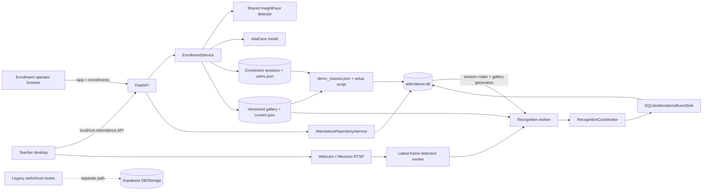

# Final Current Architecture Audit

**Audit date:** 20 November 2026 
**Evidence basis:** static inspection of the current working tree. The 10 November snapshot was not treated as current-state evidence. 
**Safety boundary:** no Supabase request, cloud operation, camera connection, model download, dependency installation, test execution, reset, clean, commit, or push was performed. Secret values and private biometric/attendance records were not inspected or reproduced. 
**Write boundary:** this report is the only file created by the audit.

## 1. Executive summary

The current working tree contains a coherent local final-attendance architecture that did not exist in the older snapshot. The candidate final product consists of:

1. a local browser-based five-pose enrollment workflow (`backend/enrollment/`, served at `/app`);
2. immutable, versioned local AdaFace gallery publication (`backend/enrollment/gallery.py` and `backend/storage/local_gallery/`);
3. SQLite students, classes, memberships, attendance sessions, roster snapshots, recognition events, attendance records and audit history (`backend/attendance/database.py`);
4. a Tkinter classroom application that uses webcam or Hikvision RTSP input, tiled detection, tracking, quality gating, AdaFace recognition, Gate A and Gate B confirmation (`desktop/` and `backend/recognition/`);
5. roster-filtered recognition and SQLite recognition-event persistence (`backend/attendance/recognition_integration.py`);
6. explicit machine recommendations followed by teacher review and finalization (`backend/attendance/service.py`, `backend/attendance/api.py`, `desktop/app.py`).

The authoritative attendance path does **not** depend on Supabase. Its final records and audit history are in `backend/storage/attendance/attendance.db`. The desktop is explicitly constructed with `LocalRecognitionSessionRepository`, while its attendance lifecycle uses the local FastAPI attendance API (`desktop/app.py:79-80`). Recognition events are written to the same SQLite attendance database through `SQLiteAttendanceEventSink` (`desktop/recognition/worker.py:586-606`).

Supabase-dependent code is still extensive in `backend/main.py`, `desktop/session/repository.py`, and `backend/scripts/generate_model_embeddings.py`. It supports the old three-pose registration flow, cloud users/embeddings, automatic detection logs and attendance candidates, unknown faces, cloud benchmarks, and video analysis. These paths do not use the frozen `RecognitionCoordinator` and must be hidden or explicitly labelled as legacy/research during the defense.

The final demo boundary is architecturally clear, but two operational gaps affect the intended script:

- local enrollment updates `enrollments/users.json` and the gallery, but does not automatically import the new identity into SQLite or add it to a class; the setup script/configuration must be run or an administration interface must be added;
- attendance audit persistence and `GET /attendance/sessions/{id}/audit` are implemented, and the client has `get_audit()`, but the desktop view does not display the audit.

The system remains a defense-ready candidate only after a controlled freeze rehearsal. The working tree is heavily modified/untracked, `backend/requirements.txt` is empty, and current test execution was intentionally not attempted in this read-only audit.

## 2. Current repository map

### 2.1 Root

| Area/file | Purpose and status | Runtime caller | Persistence | Final demo | Dissertation evidence |
|---|---|---|---|---|---|
| `backend/` | FastAPI, enrollment, recognition, attendance, research and legacy cloud code. Mixed **CURRENT + RESEARCH + LEGACY**. | FastAPI process, desktop imports, scripts | SQLite, local files, optional Supabase | **Required** | **Required** |
| `desktop/` | Tkinter camera, detection, recognition and attendance interface. **CURRENT**. | `python -m desktop` via `desktop/__main__.py` | Attendance API/SQLite; local diagnostic JSONL | **Required** | **Required** |
| `tests/` | Unit/integration/replay tests. **TEST**. | pytest/unittest | Temporary files/databases | Not at runtime | **Required evidence** |
| `docs/` | Phase documents and audits. Older documents may describe superseded state. **DOCUMENTATION**. | Human readers | Markdown | Not at runtime | **Required selectively** |
| `frontend/index.html` | Empty separate frontend placeholder. **UNUSED**. | No verified caller | None | No | No |
| `PROPOSAL_TECHNICAL_AUDIT.md` | Previous proposal-oriented audit. **DOCUMENTATION**, not runtime authority. | Human readers | Markdown | No | Supporting only |
| Root sample images | Manual/research detector inputs. **RESEARCH/TEST**, potentially sensitive. | Ad-hoc scripts | Local images | No | Only if ethically approved and anonymised |
| `.env` files | Local configuration/secrets. Values were not read. | FastAPI/camera/cloud adapters | Local secret configuration | Required only for selected camera/cloud settings | Never present values in dissertation |

### 2.2 Backend

| Area/file | Purpose and current classification | Runtime caller | Persistence | Final demo | Dissertation evidence |
|---|---|---|---|---|---|
| `backend/main.py` | ASGI entry point and router assembly, but also a large legacy monolith. Lines 246-287 create FastAPI, mount static files, instantiate local enrollment/attendance, and include both routers. Later sections implement legacy benchmark, cloud registration, recognition, camera, attendance and video routes. **CURRENT ENTRY POINT + LEGACY/RESEARCH HOST**. | Uvicorn/ASGI | Local enrollment/SQLite for new routers; Supabase/local legacy files for old routes | **Required**, but legacy routes should be hidden | Architecture/debt evidence |
| `backend/enrollment/` | Local five-pose enrollment domain. `api.py` is transport, `service.py` orchestrates validation/finalization, `repository.py` stores sessions/users, `gallery.py` publishes immutable galleries, and quality/pose/representative modules implement policy. **CURRENT**. | `EnrollmentService` constructed in `main.py:284`; `/enrollments...` | `storage/enrollments/`, `storage/local_gallery/` | **Required** | **Required** |
| `backend/recognition/` | Shared detector, alignment, model adapters, local gallery, matcher, quality, tracker, evidence aggregation, temporal gates, coordinator and offline evaluation. **CURRENT CORE + RESEARCH SUPPORT**. | Desktop workers; enrollment; offline scripts; some legacy routes use only selected adapters | Gallery and diagnostic JSONL; model files | **Required core subset** | **Required** |
| `backend/attendance/` | SQLite schema, entities, repository, recommendation/review service, API, roster filtering and recognition-event sink. **CURRENT FINAL ATTENDANCE DOMAIN**. | `main.py:281-287`; desktop HTTP client and recognition worker | `storage/attendance/attendance.db` | **Required** | **Required** |
| `backend/evaluation/` | Older benchmark dataset/metrics layer. `evaluator.py` is empty. **RESEARCH/LEGACY**. | `/run-benchmark`, `/run-all-benchmarks`, evaluation routes | Supabase evaluation tables | No | Selective research evidence |
| `backend/analysis/` | Phase 8 quality/spatial/controlled-replay analysis. **RESEARCH**. | Analysis scripts/tests | Reads research artefacts; produces summaries when executed | No | **Required for experimental chapter** |
| `backend/scripts/` | Mixed operational and research utilities. `setup_demo_attendance.py` is current demo preparation; gallery identity tools support current local state. Benchmark/replay/calibration scripts are research. Download/generate scripts are setup or legacy cloud utilities. | Command line | Local SQLite/gallery/research artefacts; one legacy script uses Supabase | Setup script **required before demo**; others no | **Required selectively** |
| `backend/static/` | `index.html` + `app.js` are the current local enrollment page. Other pages are legacy/research cloud UIs. **MIXED**. | FastAPI static mount and page routes | Browser localStorage only for enrollment session ID; server-side state elsewhere | Enrollment files **required** | UI evidence |
| `backend/storage/` | Runtime and research data root. Contains current attendance/enrollment/gallery data alongside old JSON, videos, benchmark and phase artefacts. **MIXED; sensitive**. | Repositories, workers, scripts, legacy routes | Files, SQLite, images, embeddings, JSON/JSONL | Current attendance/enrollment/gallery subsets **required** | Aggregate artefacts only; never private data |
| `backend/sql/phase_4_5_recognition_logging.sql` | Supabase recognition session/test-trial migration. **RESEARCH/UNUSED BY CURRENT DESKTOP**, because the app injects the local repository. | Manual database migration only | Supabase Postgres | No | Historical research design only |
| `backend/config/demo_classes.json` | Declarative demo classes/rosters consumed by setup script. **CURRENT DEMO CONFIG**. | `setup_demo_attendance.py` | Imported into SQLite | **Required unless replaced by admin UI** | Architecture/config evidence; do not expose real IDs |
| `backend/requirements.txt` | Dependency declaration, currently empty. **INCOMPLETE**. | Installer, if used | None | Deployment blocker | Reproducibility limitation |

### 2.3 Desktop

| Area/file | Purpose and status | Runtime caller | Persistence | Final demo | Dissertation evidence |
|---|---|---|---|---|---|
| `desktop/__main__.py`, `desktop/app.py` | Desktop entry point and UI coordinator. `FaceAttendanceDesktopApp` constructs local session journal, attendance API client, camera/detection/recognition workers and view callbacks (`desktop/app.py:60-80`). **CURRENT**. | User launches desktop | Local diagnostic journal + attendance HTTP/SQLite | **Required** | **Required** |
| `desktop/camera/` | Webcam/Hikvision source selection, validated RTSP URL construction and latest-frame capture worker. **CURRENT**. | `desktop/app.py` | None beyond runtime metadata | **Required** | Camera/IoT evidence |
| `desktop/detection/` | Latest-frame tiled detector worker and renderer. Newer frames replace unprocessed frames (`desktop/detection/worker.py:57-61`, `149-180`). **CURRENT**. | Desktop coordinator | In memory | **Required** | Detection/concurrency evidence |
| `desktop/recognition/` | Loads AdaFace/local gallery and executes `RecognitionCoordinator`. Attendance mode creates roster context and SQLite sink (`desktop/recognition/worker.py:376-399`, `582-609`). **CURRENT**. | Desktop coordinator | Gallery read; SQLite events or diagnostic JSONL | **Required** | **Required** |
| `desktop/attendance/` | Local HTTP client and presentation-state helpers. Includes `get_audit()`, although the current view does not call it (`desktop/attendance/client.py:21-148`). **CURRENT**. | `desktop/app.py` | Via local API | **Required** | **Required** |
| `desktop/views/` | Tkinter home/register/detection/recognition views. Recognition view contains class, roster, live evidence and teacher-review UI. Register view remains a placeholder relative to the real web enrollment. **CURRENT + PLACEHOLDER**. | `desktop/app.py` | None | Recognition view required; desktop registration not required | UI evidence |
| `desktop/session/` | Generic recognition-session/trial journal abstraction. Current app injects `LocalRecognitionSessionRepository`; the separate `repository.py` Supabase adapter remains but is not selected (`desktop/app.py:79`, `desktop/session/local_repository.py`). **DIAGNOSTIC CURRENT + UNUSED CLOUD ADAPTER**. | Desktop app/service | `storage/offline_sessions/sessions_trials.jsonl`; optional unused Supabase adapter | Not authoritative attendance | Research/session diagnostics |

### 2.4 Tests and documentation

`tests/` covers enrollment, removal, matching, evidence, confirmation, quality, tracking, offline integration, phase evaluation, attendance database/API/recommendation/review/recognition integration, desktop attendance and demo setup. These files are the best static evidence of intended invariants, but current pass status is **NOT VERIFIED** because this audit did not run them.

The most relevant current tests are:

- `tests/test_attendance_database.py`
- `tests/test_attendance_api.py`
- `tests/test_attendance_recognition_integration.py`
- `tests/test_attendance_recommendation_service.py`
- `tests/test_attendance_review_service.py`
- `tests/test_attendance_desktop.py`
- `tests/test_setup_demo_attendance.py`
- `tests/test_enrollment.py` and `tests/test_enrollment_api.py`
- `tests/test_matching.py`, `test_tracking.py`, `test_quality.py`, `test_confirmation.py`

Phase documents under `docs/` remain valid as experiment records only when tied to their phase and artefact. They must not override current code. In particular, any older assertion that class/roster, teacher review, final attendance or audit are missing is stale.

## 3. Final architecture

### 3.1 Recommended defense boundary

**FINAL PRODUCT**

- local `/app` five-pose enrollment;
- local enrollment session and identity metadata;
- versioned AdaFace gallery and `current.json` pointer;
- preconfigured class/roster administration via `setup_demo_attendance.py` and `demo_classes.json`;
- desktop webcam/Hikvision classroom attendance;
- frozen `RecognitionCoordinator` pipeline;
- SQLite recognition events, recommendations, teacher decisions, final attendance and audit.

**RESEARCH TOOLS**

- offline image benchmark and open-set evaluation;
- replay/quality/spatial/controlled-video analysis;
- legacy web benchmark/video pages only if clearly introduced as research utilities and their Supabase dependency is deliberately configured.

**LEGACY — HIDE DURING FINAL PRODUCT DEMO**

- old Supabase users and three-pose `/register-face` flow;
- `/recognize-face` and `/camera/*` cloud mean-embedding recognition;
- old `detection_logs`, `attendance_candidates` and automatic attendance semantics;
- legacy attendance page/dashboard/export;
- unknown-face cloud workflow;
- cloud user-management page.

This classification is verified by code. The current `/app` calls only `/enrollments...` (`backend/static/app.js:69-163`); the old attendance page calls `/recognize-face`, `/attendance-logs`, `/attendance-candidates`, `/unknown-faces`, `/camera/*` and `/cloud-health` (`backend/static/attendance.js`). The desktop final path calls `/attendance...` and uses the coordinator directly.

### 3.2 Architecture diagram

No FastAPI route directly runs the frozen `RecognitionCoordinator`. It is executed by the desktop recognition worker and offline/replay tooling. The `/attendance...` routes provide session lifecycle, recommendation and review around coordinator-produced SQLite events. `/recognize-face`, `/camera/*`, `/process-video` and web benchmarks use older direct detection/model logic rather than `RecognitionCoordinator`.

## 4. Persistence authority matrix

| Persistence | Code owner/caller | Classification | Authority and final-demo role |
|---|---|---|---|
| `backend/storage/attendance/attendance.db` | `AttendanceDatabase`, `AttendanceRepository`, attendance API and desktop event sink (`backend/attendance/database.py:17-161`) | **AUTHORITATIVE_FINAL** | Authoritative academic attendance, class membership, session roster snapshots, evidence events, final statuses and audit. Must persist and be backed up. |
| `backend/storage/enrollments/users.json` | `EnrollmentRepository.users_path` (`backend/enrollment/repository.py:35-39`, `156-191`) | **AUTHORITATIVE_FINAL** for enrollment identity metadata | Authoritative local enrollment identity metadata and associated gallery generation. It is imported/upserted into attendance students, not automatically synchronized on every enrollment. |
| `backend/storage/enrollments/<session>/session.json` and sample directories | `EnrollmentRepository` (`repository.py:58-117`) | **BIOMETRIC_ARTIFACT** | Enrollment workflow state, crops, aligned samples and metadata. Required while enrolling and retained afterward unless explicitly removed. Sensitive. |
| Per-sample `embedding.npy` cache | `EnrollmentService._embedding()` (`backend/enrollment/service.py:235-252`) | **BIOMETRIC_ARTIFACT** | Cached biometric computation used at finalization. Sensitive, not attendance authority. |
| `backend/storage/local_gallery/<generation>/manifest.json` and embedding files | `LocalGalleryPublisher.publish()` (`backend/enrollment/gallery.py:32-80`) | **BIOMETRIC_ARTIFACT** | Authoritative recognition gallery generation. Immutable publication includes copied-forward identities and new prototypes. Sensitive. |
| `backend/storage/local_gallery/current.json` | `LocalGalleryPublisher`, `LocalGalleryProvider` (`gallery.py:20`, `72-76`; `recognition/local_gallery.py:13-107`) | **BIOMETRIC_ARTIFACT** | Authoritative pointer to active gallery manifest. Required for enrollment continuation and desktop recognition. |
| `backend/storage/offline_sessions/sessions_trials.jsonl` | `LocalRecognitionSessionRepository` (`desktop/session/local_repository.py:9-42`) | **DIAGNOSTIC** | Current generic recognition session/trial journal; not final academic attendance. |
| Other offline attendance/event JSONL | `LocalAttendanceSink` (`backend/recognition/events.py:25-57`) | **DIAGNOSTIC** | Development/replay confirmed-event log. Attendance mode substitutes the SQLite sink. |
| Phase, benchmark, replay and evaluation artefacts under `backend/storage/` | analysis/offline scripts | **RESEARCH** | Dissertation evidence when aggregate, provenance-controlled and ethically usable; never final attendance. |
| Supabase `users`, `face_images`, `face_embeddings` + buckets | legacy `backend/main.py`, legacy embedding script | **LEGACY** | Old identity/three-pose registration and recognition. Not authoritative for current final product. |
| Supabase `detection_logs`, `attendance_candidates`, `unknown_faces` + bucket | legacy recognition/camera/attendance routes | **LEGACY** | Old automatic observation/candidate semantics. Not final attendance. |
| Supabase `evaluation_runs`, `evaluation_results` | benchmark routes | **RESEARCH** | Cloud research results only. |
| Supabase video tables and evidence bucket | video routes | **RESEARCH/LEGACY** | Video experiments; not final attendance. |
| Supabase `recognition_sessions`, `recognition_test_trials` | `desktop/session/repository.py` | **UNUSED** by current desktop | Adapter remains, but `desktop/app.py:79` injects the local journal repository. |
| Legacy local `storage/users.json`, `attendance_logs.json`, `attendance_candidates.json`, CSV, images/embeddings | old `backend/main.py` constants and compatibility code | **LEGACY** | Not authoritative for the final local architecture. |

Explicit answers:

- **Authoritative academic attendance:** SQLite `attendance.db`, specifically `attendance_sessions`, `session_roster`, `recognition_events`, `attendance_records` and `attendance_audit`.
- **Authoritative class membership:** SQLite `classes` and `class_members`. Each session copies active membership into `session_roster`, which becomes authoritative historical membership for that session.
- **Authoritative enrollment identity metadata:** `backend/storage/enrollments/users.json`. SQLite receives a copied administrative student record through `import_enrollment_users()`.
- **Authoritative biometric/gallery artifacts:** the generation selected by `backend/storage/local_gallery/current.json`, its manifest and embeddings; enrollment samples/caches are source biometric artifacts.
- **What remains Supabase-dependent:** legacy users/three-pose registration, legacy mean-embedding recognition, old web camera attendance/logs/candidates/unknown faces, cloud health, cloud benchmark persistence/pages, video sessions/detections/summaries/evidence, the unused cloud session adapter and `generate_model_embeddings.py`.

## 5. Current runtime flow

### 5.1 Enrollment to gallery

1. `GET /app` returns `backend/static/index.html` (`backend/main.py:250-252`).
2. The browser posts identity metadata to `POST /enrollments`; `start_enrollment()` calls `EnrollmentService.start_session()` (`backend/enrollment/api.py:28-34`, `service.py:35-42`).
3. `EnrollmentRepository.create_session()` creates a session directory, `samples/`, and `session.json` (`backend/enrollment/repository.py:43-60`, `75-88`).
4. The browser captures front, left, right, up and down samples and posts them to `/enrollments/{session}/samples` (`backend/static/app.js:69-135`; `backend/enrollment/config.py:5-20`).
5. `EnrollmentService._submit_sample()` decodes the image, requires exactly one face, evaluates quality and pose, performs five-point alignment, detects exact/near duplicates and writes crop/aligned/metadata files (`backend/enrollment/service.py:64-128`).
6. `EnrollmentService.finalize()` computes AdaFace embeddings, selects pose representatives, calculates a normalized mean, publishes a gallery and completes user metadata (`backend/enrollment/service.py:149-203`).
7. `LocalGalleryPublisher.publish()` writes a temporary generation, validates it, atomically promotes it, then atomically updates `current.json` (`backend/enrollment/gallery.py:32-84`).

### 5.2 Class/roster preparation

1. `setup_demo_attendance.py` loads `enrollments/users.json`, `demo_classes.json` and the current gallery without inference (`backend/scripts/setup_demo_attendance.py:67-152`, `186-211`).
2. `import_enrollment_users()` upserts identity metadata into SQLite students (`backend/attendance/import_enrollment_users.py:17-46`).
3. The script creates/updates classes, optionally replaces roster membership, and adds configured students (`setup_demo_attendance.py:211-232`).
4. It checks that classes are active, rosters are non-empty and at least one roster identity exists in the gallery (`setup_demo_attendance.py:233-311`).

**GAP:** there is no current web/desktop class administration endpoint or UI. `/attendance/classes` and `/attendance/classes/{id}/roster` are read-only. A newly enrolled examiner is not automatically inserted into students/class membership. The demo must preconfigure the identity in `demo_classes.json` and run the setup tool after enrollment, or this arrow fails.

### 5.3 Attendance creation and roster snapshot

1. The desktop lists classes/rosters through `AttendanceApiClient.list_classes()` and `get_class_roster()` (`desktop/attendance/client.py:38-42`; `desktop/app.py:482-528`).
2. `_start_recognition()` posts class ID, exact gallery generation, recognition config, camera source and operator to `POST /attendance/sessions` (`desktop/app.py:442-477`; `client.py:44-63`).
3. The API calls `AttendanceRepository.create_attendance_session()` and initializes one `NOT_OBSERVED` attendance record per snapshotted roster member (`backend/attendance/api.py:244-260`; `repository.py:271-340`, `479-531`).
4. `session_roster` is an immutable historical snapshot for recognition and final review; later class-membership edits do not change it.

### 5.4 Camera, detection, tracking and recognition

1. `build_recognition_camera_source()` selects webcam index 0 or validated Hikvision RTSP (`desktop/camera/recognition_source.py:6-15`, `desktop/camera/hikvision.py:48-85`).
2. `CameraWorker` owns OpenCV capture and retains only the latest frame (`desktop/camera/worker.py:55-128`).
3. `DetectionWorker` also keeps only one pending frame and executes the configured tiled detector (`desktop/detection/worker.py:57-61`, `149-180`, `391-400`).
4. `RecognitionWorker.start_attendance_session()` creates an attendance repository context. `create_session_recognition_context()` requires an active session, loads its roster snapshot, verifies gallery generation and filters the immutable global gallery to roster identities (`desktop/recognition/worker.py:177-195`, `376-399`; `backend/attendance/recognition_integration.py:71-146`).
5. `RecognitionCoordinator.process()` performs IoU tracking, quality measurement, top-K evidence buffering, AdaFace embedding, max-prototype cosine matching, Gate A score/margin rejection and Gate B temporal confirmation (`backend/recognition/coordinator.py:38-180`).
6. Current provisional configuration is similarity 0.40, margin 0.05, minimum size 24, minimum sharpness 12, top 3 evidence within 5 seconds, and at least 3 observations/attempts over 0.5 seconds (`backend/recognition/offline_development.json`). These are development settings, not production-calibrated claims.

### 5.5 Recognition event to final attendance

1. A confirmation transition creates `ConfirmedIdentityEvent` in `RecognitionCoordinator` (`backend/recognition/coordinator.py:164-178`).
2. `SQLiteAttendanceEventSink.accept()` validates session, generation, active state and roster, then calls `AttendanceRepository.insert_recognition_event()`; database uniqueness enforces at most one event per session/student (`backend/attendance/recognition_integration.py:148-224`, `database.py:76-97`).
3. The desktop polls `/attendance/sessions/{id}/records` for live evidence (`desktop/app.py:1569-1607`).
4. The teacher ends the session. `POST .../end` first freezes event ingestion, then calls `build_or_refresh_attendance_suggestions()` (`backend/attendance/api.py:285-298`).
5. A valid confirmed event for the session/gallery yields `SUGGESTED_PRESENT`; absent evidence stays `NOT_OBSERVED`; inconsistent evidence yields `NEEDS_REVIEW` (`backend/attendance/service.py:41-93`).
6. The teacher selects Present, Absent or Excused. `review_attendance_record()` requires an ended session, a roster member and a named actor; it preserves recognition evidence and appends audit in the repository transaction (`backend/attendance/service.py:96-143`, `repository.py:598-708`).
7. `finalize_reviewed_attendance_session()` refuses finalization until every roster member has exactly one record and a non-null final decision (`backend/attendance/service.py:146-189`).
8. Audit is stored in `attendance_audit` and exposed through `GET /attendance/sessions/{id}/audit` (`backend/attendance/api.py:336-344`). The client implements `get_audit()` (`desktop/attendance/client.py:100-101`).

**GAP:** the desktop does not currently call `get_audit()` or render audit history. Finalized status is shown, but audit demonstration requires the API, database inspection, or a small future UI addition.

## 6. Route and page classification

No route below has an authentication/authorization dependency. The classification is a defense boundary, not a security approval.

### 6.1 Final demo routes

| Route/page | Classification | Persistence/dependency | Coordinator use |
|---|---|---|---|
| `GET /app` | **FINAL_DEMO** | Local static enrollment page | No; enrollment uses detector/AdaFace directly |
| `POST /enrollments` | **FINAL_DEMO** | Local enrollment directory | No |
| `GET /enrollments/{session}` | **FINAL_DEMO** | Local session JSON | No |
| `POST /enrollments/{session}/samples` | **FINAL_DEMO** | Local crop/aligned/metadata | No |
| `DELETE /enrollments/{session}/samples/{sample}` | **FINAL_DEMO** | Local session files | No |
| `GET /enrollments/{session}/samples/{sample}/preview` | **FINAL_DEMO** | Local image | No |
| `POST /enrollments/{session}/finalize` | **FINAL_DEMO** | Local user metadata/gallery | No |
| `DELETE /enrollments/{session}` | **FINAL_DEMO/RECOVERY** | Removes unfinished local session | No |
| `GET /attendance/classes` | **FINAL_DEMO** | SQLite | No; lifecycle API |
| `GET /attendance/classes/{class}/roster` | **FINAL_DEMO** | SQLite | No |
| `POST /attendance/sessions` | **FINAL_DEMO** | SQLite roster snapshot/records | No; prepares coordinator context |
| `GET /attendance/sessions/{session}` | **FINAL_DEMO** | SQLite | No |
| `POST /attendance/sessions/{session}/refresh-suggestions` | **FINAL_DEMO** | SQLite | Consumes coordinator events |
| `GET /attendance/sessions/{session}/records` | **FINAL_DEMO** | SQLite | No |
| `POST /attendance/sessions/{session}/end` | **FINAL_DEMO** | SQLite | Ends event window and recommends |
| `POST /attendance/sessions/{session}/students/{student}/review` | **FINAL_DEMO** | SQLite final decision/audit | No |
| `POST /attendance/sessions/{session}/finalize` | **FINAL_DEMO** | SQLite | No |
| `GET /attendance/sessions/{session}/audit` | **FINAL_DEMO API**, no current UI | SQLite | No |

### 6.2 Research/developer routes

| Route/page | Classification | Notes |
|---|---|---|
| `GET /evaluation-page` | **RESEARCH_DEMO** | Static page renders locally; data/actions are Supabase-dependent. |
| `POST /run-benchmark`, `POST /run-all-benchmarks` | **RESEARCH_DEMO** | Older benchmark pipeline; writes Supabase evaluation tables; no coordinator. |
| `GET /evaluation-runs`, `/evaluation-latest-comparison`, `/evaluation-runs/{id}` | **RESEARCH_DEMO** | Supabase reads. |
| `POST /test-recognition-model` | **DEVELOPER_ONLY/RESEARCH** | Direct model test, no coordinator. |
| `GET /video-analysis-page`, `/video-summary-page`, `/video-evidence-page` | **RESEARCH_DEMO** | HTML can render without cloud, but useful operations require Supabase. |
| `POST /video-sessions`, `POST /process-video`, summary/evidence routes, `GET /video-sessions` | **RESEARCH_DEMO/LEGACY IMPLEMENTATION** | Supabase video tables/storage, direct legacy processor, no coordinator. `GET /video-sessions` is declared twice (`backend/main.py:3463`, `4240`). |
| `GET /test-supabase`, `GET /cloud-health` | **DEVELOPER_ONLY** | Explicit cloud diagnostics; never use during offline final demo. |
| `GET /` | **DEVELOPER_ONLY** | API status message, not product UI. |

### 6.3 Legacy routes to hide

| Route/page | Classification | Why hidden |
|---|---|---|
| `GET /users-page`, `/users`, user status/existence and `DELETE /users/{id}` | **LEGACY_HIDE** | Supabase user/face/embedding state, not local enrollment authority. |
| `POST /register-face`, `POST /validate-face` | **LEGACY_HIDE** | Old front/left/right three-pose flow (`backend/main.py:1394-1487`, `1646-1994`), cloud storage/tables, no local gallery publication. |
| `POST /recognize-face` | **LEGACY_HIDE** | Uses cloud mean embeddings and direct recognition; no frozen coordinator/roster/teacher authority. |
| `POST /camera/start`, `/camera/stop`, `/camera/reload-recognition-data`; `GET /camera/status`, `/camera/feed` | **LEGACY_HIDE** | Old FastAPI RTSP worker and cloud cache/logging; not desktop final path. |
| `GET /attendance-page`, logs/export/candidates/dashboard routes | **LEGACY_HIDE** | `detection_logs` and `attendance_candidates` are not teacher-final attendance. |
| Unknown-face list/delete routes | **LEGACY_HIDE** | Supabase table/storage; outside final product. |

### 6.4 Supabase unavailable: what still works

- **Works locally if local models/files are present:** `/app`, all `/enrollments...`, all `/attendance...`, desktop attendance, local setup script, local offline/replay tools.
- **Page shell renders but functionality is incomplete/fails:** evaluation, video analysis/summary/evidence, users and legacy attendance pages.
- **Does not function meaningfully:** legacy cloud users/registration/recognition/camera logs/attendance candidates/unknown faces/cloud health, cloud benchmark result APIs and video APIs.

`backend/main.py:238-245` makes Supabase client construction optional and comments that local enrollment remains usable without it. This does not make legacy route bodies safe; they still dereference `supabase`.

## 7. Supabase dependency map

### 7.1 Modules importing/constructing a client

- `backend/main.py:1-4`, `235-245`: optional global legacy client.
- `desktop/session/repository.py:124-142`: lazy client for recognition session/test trial tables. Current app does not select this repository.
- `backend/scripts/generate_model_embeddings.py:8-39`: explicit legacy cloud generation utility.

No module in `backend/enrollment/`, `backend/attendance/`, or `backend/recognition/local_gallery.py` imports Supabase. `local_gallery.py` explicitly documents the boundary.

### 7.2 Tables referenced

| Domain | Tables | Classification |
|---|---|---|
| Legacy identity | `users`, `face_images`, `face_embeddings` | **LEGACY** |
| Legacy automatic attendance | `detection_logs`, `attendance_candidates`, `unknown_faces` | **LEGACY** |
| Web benchmarks | `evaluation_runs`, `evaluation_results` | **RESEARCH** |
| Video analysis | `video_sessions`, `video_detection_logs`, `video_attendance_summary`, `video_evidence_frames` | **RESEARCH/LEGACY** |
| Desktop cloud session adapter | `recognition_sessions`, `recognition_test_trials`, plus `users` lookup | **UNUSED BY CURRENT APP/RESEARCH** |

### 7.3 Storage buckets referenced

- `face-images`
- `face-embeddings`
- `unknown-faces`
- `video-evidence-frames`
- `exports` appears in the cloud-health bucket check

The old three-pose registration uploads raw/aligned face images to `face-images`, stores metadata in `face_images`, and relies on generated embeddings/metadata in `face_embeddings`. Legacy recognition downloads mean embeddings from `face-embeddings`. This is separate from the current local five-pose gallery.

## 8. Deployment risks

### 8.1 Runtime filesystem state

Current enrollment writes directly to the application filesystem:

- identity metadata: `backend/storage/enrollments/users.json`;
- session state: `backend/storage/enrollments/<session>/session.json`;
- sample artifacts: per-sample crop, aligned image, metadata and embedding cache;
- gallery: `backend/storage/local_gallery/<generation>/manifest.json` plus prototype `.npy` files;
- active pointer: `backend/storage/local_gallery/current.json`;
- final attendance: `backend/storage/attendance/attendance.db`;
- optional diagnostic session journal: `backend/storage/offline_sessions/sessions_trials.jsonl`.

Runtime models must also exist:

- InsightFace Buffalo_L detector pack, with preflight expecting `det_10g.onnx` under the user model directory (`backend/recognition/offline_runtime.py:5-9`);
- AdaFace repository/config/checkpoint under `backend/model_weights/adaface/ir101_webface4m/`, including `pretrained_model/model.yaml` and `model.pt` (`backend/recognition/adaface_loader.py:20-27`, `120-143`).

Deploying unchanged to an ephemeral filesystem would lose enrollment sessions, accepted samples, user metadata, gallery generations, the active pointer, classes, rosters, recognition events, teacher decisions and audit history on restart/redeploy. A partially retained deployment is also unsafe: retaining `users.json` without its gallery, or `attendance.db` without the referenced gallery generation, breaks provenance and demo continuity.

For defense, use a persistent local volume or a fixed local machine, back up the complete related storage set together, and verify write permissions before the session. Cloud synchronization is intentionally outside this audit and should not be introduced immediately before defense.

### 8.2 Other readiness risks

- `backend/requirements.txt` is empty; clean-machine reproducibility is not frozen.
- FastAPI static paths are relative (`StaticFiles(directory="static")` and `FileResponse("static/index.html")`), so launch working directory matters (`backend/main.py:248-252`).
- The current working tree contains many untracked/modified implementation files. A known-good release snapshot is not yet evidenced.
- No authentication or role enforcement protects enrollment, class data, review, finalization or destructive legacy routes.
- The attendance desktop depends on a separately running local FastAPI server at `http://127.0.0.1:8000` by default (`desktop/attendance/client.py:29-32`).
- Desktop recognition reads/writes the SQLite file directly for events while lifecycle calls use HTTP. This is acceptable for the current single-host demo but is not a distributed deployment design.
- Provisional thresholds explicitly remain development values (`backend/recognition/offline_development.json`).
- The old cloud routes share one FastAPI application with the final local routes, making accidental navigation or API use possible.
- Current automated test outcome is not verified by this read-only audit.

## 9. Demo and presentation source-code map

### 9.1 Examiner-facing demo script

| Intended arrow | Current implementation | Result |
|---|---|---|
| Examiner opens web enrollment | `GET /app` → `backend/static/index.html`; `backend/main.py:250-252` | **IMPLEMENTED** |
| Five-pose enrollment | `backend/static/app.js`; `/enrollments`; `EnrollmentService.submit_sample()`; `config.POSE_TARGETS` | **IMPLEMENTED** |
| Finalization | `POST /enrollments/{id}/finalize` → `EnrollmentService.finalize()` | **IMPLEMENTED** |
| New gallery generation | `LocalGalleryPublisher.publish()` and atomic `current.json` update | **IMPLEMENTED** |
| Examiner added to class roster | `import_enrollment_users()` + `setup_demo_attendance.setup_demo()` + `demo_classes.json` | **GAP IN LIVE UI/AUTOMATION**: requires config/script step after enrollment |
| Desktop selects class | `desktop/app.py:_load_attendance_classes()`, `_load_selected_class_roster()`; recognition view | **IMPLEMENTED** after setup |
| Hikvision session starts | `build_recognition_camera_source()`, `build_hikvision_rtsp_source()`, `CameraWorker.start()` | **IMPLEMENTED**, live environment not verified here |
| Session roster snapshot | `POST /attendance/sessions` → `AttendanceRepository.create_attendance_session()` | **IMPLEMENTED** |
| Roster-filtered recognition | `create_session_recognition_context()`, `filter_gallery_for_roster()` | **IMPLEMENTED** |
| Recognition events | `RecognitionCoordinator` → `SQLiteAttendanceEventSink` → `insert_recognition_event()` | **IMPLEMENTED** |
| End session | `desktop/app.py:_end_attendance_session()` → `POST .../end` | **IMPLEMENTED** |
| Suggestions | `build_or_refresh_attendance_suggestions()` | **IMPLEMENTED** |
| Teacher decisions | desktop review controls → `review_attendance_record()` | **IMPLEMENTED** |
| Finalize | desktop finalize → `finalize_reviewed_attendance_session()` | **IMPLEMENTED** |
| Audit | SQLite `attendance_audit`, API route, client `get_audit()` | **PARTIAL DEMO GAP**: stored/API-accessible, not displayed in desktop |

The safest defense rehearsal pre-enrolls the examiner or pauses after enrollment to update the demo class configuration and run the setup/readiness script. Do not imply automatic roster synchronization.

### 9.2 Best files/functions to show an examiner

| Presentation topic | Best source evidence |
|---|---|
| Purpose / architecture | `desktop/app.py:60-80`, `backend/main.py:246-287`, this report’s architecture diagram |
| Enrollment | `backend/enrollment/service.py:35-203`, `backend/enrollment/api.py`, `backend/static/app.js` |
| Face detection | `backend/recognition/face_detector.py:InsightFaceDetector`, `desktop/detection/worker.py:_detect_tiled()` |
| Tracking | `backend/recognition/tracker.py:FaceTracker`, `backend/recognition/coordinator.py:74-103` |
| Quality gate | `backend/recognition/quality.py:measure_quality()/decide_quality()`, `offline_development.json` |
| AdaFace | `backend/recognition/adaface_model.py:AdaFaceModel`, `adaface_preprocessing.py`, `adaface_loader.py` |
| Gallery/prototypes | `backend/enrollment/gallery.py:LocalGalleryPublisher.publish()`, `representatives.py:select_representatives()`, `recognition/local_gallery.py` |
| Gate A | `backend/recognition/temporal.py:gate_a()`, `identity_matcher.py:match_identity()` |
| Gate B | `backend/recognition/temporal.py:TemporalConfirmation`, `coordinator.py:157-178` |
| Class/roster | `backend/attendance/database.py`, `repository.py:create_class()/add_class_member()`, `scripts/setup_demo_attendance.py:setup_demo()` |
| Attendance session | `AttendanceRepository.create_attendance_session()` and `backend/attendance/api.py:244-260` |
| Session roster snapshot | `backend/attendance/repository.py:271-340`, `database.py:66-74` |
| Roster filtering | `backend/attendance/recognition_integration.py:filter_gallery_for_roster()/create_session_recognition_context()` |
| Recognition event | `backend/recognition/events.py:ConfirmedIdentityEvent`, `SQLiteAttendanceEventSink.accept()`, `repository.py:insert_recognition_event()` |
| Recommendation | `backend/attendance/service.py:build_or_refresh_attendance_suggestions()` |
| Teacher review | `backend/attendance/service.py:review_attendance_record()`, `desktop/app.py:_review_selected_student()` |
| Final attendance | `finalize_reviewed_attendance_session()`, `attendance_records` schema |
| Audit | `AttendanceRepository.update_attendance_review()/list_attendance_audit()`, `GET .../audit` |
| Evaluation | `backend/recognition/offline_evaluation.py`, `backend/scripts/offline_benchmark.py`, `backend/analysis/` |
| Camera / IoT | `desktop/camera/hikvision.py`, `recognition_source.py`, `worker.py` |
| Limitations | `backend/requirements.txt`, provisional config, route duplication/cloud split, Section 8 of this report |

## 10. Remaining gaps

### Defense-critical

1. **Roster synchronization gap:** enrollment does not create/update SQLite student/class membership automatically. Freeze and rehearse the setup-script step or implement a narrowly scoped administration action before final freeze.
2. **Audit visibility gap:** audit is persisted and retrievable but not shown in the desktop. Decide whether an API demonstration is acceptable.
3. **Environment freeze gap:** empty requirements and unverified current test run prevent clean reproducibility claims.
4. **Working-tree freeze gap:** current implementation is largely untracked/modified. Establish a known-good recoverable snapshot through the owner’s normal version-control process after validation.
5. **Security boundary gap:** no authentication/authorization. Keep the defense service bound to the trusted local machine/network and do not claim production security.
6. **Legacy navigation/API gap:** old routes remain reachable in the same app. Avoid the legacy attendance/users/video navigation in the final product demonstration.

### Dissertation/engineering

- Current operating thresholds are provisional and need to be described as such.
- Stored research results must be tied to their exact gallery/config/dataset phase.
- No automatic teacher-final attendance export exists; the legacy CSV is detection-log export and must not be presented as final attendance.
- No retention, consent, encryption or institutional-approval mechanism is evidenced in code.
- No liveness/anti-spoofing implementation is present.
- `backend/evaluation/evaluator.py` and `frontend/index.html` are empty.
- Duplicate `GET /video-sessions` routes and the monolithic `backend/main.py` remain technical debt.
- Real live-camera throughput and classroom robustness are not established by static code existence.

## 11. Files that should not be touched before defense

After a successful rehearsal, freeze these as a coupled set unless a defect blocks the demo:

- `backend/attendance/` — final academic data model and invariants;
- `backend/enrollment/` — enrollment validation and atomic gallery publication;
- `backend/recognition/coordinator.py`, `tracker.py`, `quality.py`, `evidence.py`, `identity_matcher.py`, `temporal.py`, `events.py`, `local_gallery.py` — frozen recognition semantics;
- `backend/recognition/offline_development.json` — demonstrated operating point; changing it invalidates comparison/rehearsal evidence;
- `backend/recognition/adaface_loader.py`, `adaface_model.py`, `adaface_preprocessing.py` and the validated local checkpoint/config;
- `desktop/app.py`, `desktop/camera/`, `desktop/detection/`, `desktop/recognition/`, `desktop/attendance/`, `desktop/views/recognition_view.py` — final desktop wiring;
- `backend/main.py:246-287` and the local router mounts;
- `backend/static/index.html`, `app.js`, `style.css` — enrollment UI;
- `backend/scripts/setup_demo_attendance.py` and the validated `backend/config/demo_classes.json`;
- the coherent runtime data set: `storage/enrollments/`, `storage/local_gallery/`, and `storage/attendance/attendance.db`.

“Do not touch” does not mean these files are perfect. It means last-minute refactoring carries more risk than benefit. Legacy code should be hidden through demo discipline rather than aggressively deleted immediately before defense. Never edit SQLite, manifests, embeddings or `current.json` manually.

## 12. Recommended final freeze checklist

### Architecture and data

- [ ] Confirm the final product statement names only local five-pose enrollment, preconfigured roster administration, desktop recognition and SQLite teacher-final attendance.
- [ ] Back up `storage/enrollments/`, `storage/local_gallery/` and `storage/attendance/` together to a protected location.
- [ ] Verify `current.json` loads the expected gallery generation and that SQLite demo sessions reference that generation.
- [ ] Confirm demo class IDs/rosters without placing private identifiers in slides or logs.
- [ ] Run `setup_demo_attendance.py` in the intended mode and preserve its readiness result privately.

### Environment

- [ ] Freeze a known working Python environment and dependency list.
- [ ] Verify local InsightFace detector and AdaFace config/checkpoint files.
- [ ] Document exact FastAPI launch working directory and desktop launch command.
- [ ] Confirm the attendance API is reachable at the desktop’s configured base URL.
- [ ] Keep Supabase optional/unconfigured for the final local product demonstration unless a research segment explicitly needs it.

### Verification

- [ ] Run the full automated suite in a disposable/test-safe environment and record the result.
- [ ] Rehearse webcam and Hikvision source selection without exposing credentials.
- [ ] Rehearse enrollment → gallery → roster setup → attendance → review → finalization.
- [ ] Verify a non-roster identity cannot be emitted in attendance mode.
- [ ] Verify “Not Observed” remains non-final until the teacher selects a status.
- [ ] Verify finalization fails while any roster member is unreviewed.
- [ ] Demonstrate or query audit history after review.
- [ ] Rehearse recovery if the camera or local API is unavailable.

### Presentation controls

- [ ] Open `/app`, not `/users-page` or `/attendance-page`.
- [ ] Use the desktop for final attendance, not `/recognize-face` or `/camera/*`.
- [ ] Label benchmark/video pages as research tools if shown.
- [ ] Do not call preliminary results production accuracy or real-time proof.
- [ ] Do not display `.env`, RTSP URLs, secrets, real IDs, face images, embeddings or private attendance rows.
- [ ] State the two current demo gaps honestly: roster setup is a script/config step; audit lacks a desktop panel.

### Freeze and recovery

- [ ] Create an owner-approved recoverable version-control snapshot only after tests and rehearsal succeed.
- [ ] Record hashes/version identifiers for the demonstrated code, gallery generation and configuration.
- [ ] Stop feature work after freeze; accept only defense-blocking fixes with repeat verification.
- [ ] Keep an offline backup and a fallback webcam/demo-data plan.

---

CURRENT_SQLITE_ATTENDANCE = YES 
CURRENT_CLASS_ROSTER = YES 
CURRENT_TEACHER_REVIEW = YES 
CURRENT_AUDIT = YES 
CURRENT_FIVE_POSE_ENROLLMENT = YES 
FINAL_ATTENDANCE_DEPENDS_ON_SUPABASE = NO 
LEGACY_CLOUD_PATHS_STILL_PRESENT = YES 
FINAL_DEMO_ARCHITECTURE_CLEAR = YES
